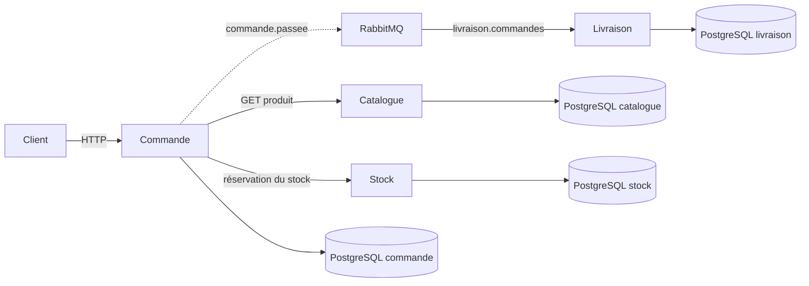

# Documentation technique — Distrilog

## 1. Objet

Distrilog est une application e-commerce de démonstration découpée en quatre microservices Python/FastAPI. Chaque service possède ses propres tables et communique par API HTTP ou par événement RabbitMQ.

Le déploiement Docker Compose lance neuf conteneurs : quatre API, quatre bases PostgreSQL et RabbitMQ.

## 2. Architecture



Le service **Commande** orchestre le parcours synchrone : il consulte Catalogue, réserve le stock, puis enregistre la commande. Il publie ensuite un événement pour que Livraison crée le bon de livraison de façon asynchrone.

| Service | Port hôte | Port conteneur | Responsabilité | Table principale |
|---|---:|---:|---|---|
| Catalogue | 8001 | 8000 | Enregistrer et consulter les produits | `produits` |
| Stock | 8002 | 8000 | Définir, consulter et réserver les quantités | `stock` |
| Commande | 8003 | 8000 | Orchestrer et enregistrer les commandes | `commandes` |
| Livraison | 8004 | 8000 | Consommer les événements et exposer les livraisons | `bons` |
| RabbitMQ | 5672 / 15672 | 5672 / 15672 | Transport des événements et interface de gestion | — |

## 3. Données

Chaque service accède uniquement à sa base. Il n’y a pas de clé étrangère entre les bases ; le SKU relie les informations produit et stock, et `commande_id` relie la livraison à la commande.

| Table | Colonnes | Clé |
|---|---|---|
| `produits` | `sku`, `nom`, `prix` | `sku` |
| `stock` | `sku`, `quantite` | `sku` |
| `commandes` | `id`, `sku`, `quantite`, `total` | `id` auto-incrémenté |
| `bons` | `event_id`, `commande_id`, `sku`, `quantite` | `event_id` |

Les tables sont créées au démarrage par SQLAlchemy (`Base.metadata.create_all`). Le projet ne contient pas de mécanisme de migration de schéma.

## 4. API HTTP

Toutes les API acceptent et renvoient du JSON. FastAPI expose une documentation interactive sur `/docs` pour chaque service.

### Catalogue — `http://localhost:8001`

| Méthode et route | Corps / résultat | Codes notables |
|---|---|---|
| `POST /produits` | Corps : `{"sku":"PAL-01","nom":"Palette eau","prix":12.5}` | `201` créé, `409` SKU déjà présent |
| `GET /produits` | Liste des produits | `200` |
| `GET /produits/{sku}` | Détail d’un produit | `200`, `404` inconnu |

### Stock — `http://localhost:8002`

| Méthode et route | Corps / résultat | Codes notables |
|---|---|---|
| `PUT /stock/{sku}` | Corps : `{"quantite":10}` ; crée ou remplace la quantité | `200` |
| `GET /stock/{sku}` | Retourne le SKU et sa quantité | `200`, `404` inconnu |
| `POST /stock/{sku}/reserve` | Corps : `{"quantite":2}` ; décrémente la quantité | `200`, `409` SKU absent ou stock insuffisant |

La réservation est effectuée par un seul `UPDATE` conditionnel (`quantite >= quantité demandée`). Une réservation concurrente ne peut donc pas consommer une quantité déjà réservée.

### Commande — `http://localhost:8003`

| Méthode et route | Corps / résultat | Codes notables |
|---|---|---|
| `POST /commandes` | Corps : `{"sku":"PAL-01","quantite":2}` ; retour : `id`, `sku`, `quantite`, `total` | `201`, `404` produit inconnu, `409` stock insuffisant, `503` dépendance indisponible |
| `GET /commandes` | Liste des commandes enregistrées | `200` |

### Livraison — `http://localhost:8004`

| Méthode et route | Résultat | Codes notables |
|---|---|---|
| `GET /livraisons` | Liste des bons avec `commande_id`, `sku` et `quantite` | `200` |

Livraison n’a pas de route HTTP d’écriture : les bons sont créés par le consommateur RabbitMQ.

## 5. Parcours d’une commande

1. Le client appelle `POST /commandes`.
2. Commande demande le produit à `GET /produits/{sku}` sur Catalogue et récupère son prix.
3. Commande appelle `POST /stock/{sku}/reserve` sur Stock.
4. Si la réservation réussit, Commande enregistre `sku`, `quantite` et `total = prix × quantité` dans sa base.
5. Commande publie l’événement `commande.passee` et renvoie le résultat HTTP `201`.
6. Livraison consomme l’événement et ajoute un bon dans sa base.

Le service Commande répond sans attendre que le bon de livraison soit créé.

## 6. Événements RabbitMQ

- Exchange : `distrilog.events` (type `topic`, durable).
- Routing key : `commande.passee`.
- Queue consommée par Livraison : `livraison.commandes` (durable).
- Le corps est un JSON contenant `event_id` (UUID), `commande_id`, `sku` et `quantite`.
- `event_id` est la clé primaire de `bons` : un événement déjà traité est ignoré comme doublon.

La publication utilise une connexion RabbitMQ ouverte et fermée pour chaque événement. Le producteur n’active ni confirmation de publication ni mode de message persistant. Si la publication échoue, l’erreur est journalisée et la commande reste enregistrée ; aucun mécanisme Outbox ne republie l’événement.

## 7. Résilience et erreurs

- Les appels HTTP utilisent un délai d’attente de 2 secondes.
- Tenacity retente jusqu’à trois fois les erreurs de transport HTTP, avec une attente exponentielle. Les réponses HTTP métier ne sont pas retentées.
- Le disjoncteur protège l’appel à Stock : il s’ouvre après trois échecs et se réinitialise après 10 secondes.
- Si Catalogue est inaccessible, Commande répond `503`. Si Stock est inaccessible ou si son disjoncteur est ouvert, Commande répond également `503`.
- Une quantité insuffisante provoque `409`. Un SKU produit absent provoque `404`.
- Le consommateur Livraison est lancé dans un thread de fond au démarrage du service. Le code ne prévoit pas de boucle de reconnexion après une perte de connexion RabbitMQ.

## 8. Configuration

| Variable | Utilisée par | Valeur locale par défaut | Valeur Docker Compose |
|---|---|---|---|
| `DATABASE_URL` | Tous les services | Base SQLite propre au service | URL PostgreSQL propre à chaque service |
| `CATALOGUE_URL` | Commande | `http://localhost:8001` | `http://catalogue:8000` |
| `STOCK_URL` | Commande | `http://localhost:8002` | `http://stock:8000` |
| `RABBIT_HOST` | Commande, Livraison | `localhost` | `rabbitmq` |

En Docker Compose, les quatre bases ont chacune un volume nommé (`catalogue_data`, `stock_data`, `commande_data`, `livraison_data`). Les contrôles de santé des bases et de RabbitMQ conditionnent le démarrage des services dépendants.

## 9. Lancement

### Avec Docker Compose

À la racine du dépôt :

```bash
docker compose up -d --build
docker compose ps
docker compose logs -f commande
```

Arrêter les conteneurs sans supprimer les données persistées :

```bash
docker compose down
```

Interfaces disponibles après démarrage :

- Catalogue : <http://localhost:8001/docs>
- Stock : <http://localhost:8002/docs>
- Commande : <http://localhost:8003/docs>
- Livraison : <http://localhost:8004/docs>
- Console RabbitMQ : <http://localhost:15672> (configuration de démonstration `guest` / `guest`)

### En local, sans conteneurs applicatifs

Créer un environnement Python et installer les dépendances :

```bash
python -m venv .venv
# Windows PowerShell
.\.venv\Scripts\Activate.ps1
# macOS / Linux
source .venv/bin/activate
pip install -r requirements.txt
```

Lancer RabbitMQ séparément, puis démarrer chaque API depuis son dossier avec `uvicorn main:app --port <port> --reload`. Les valeurs par défaut utilisent SQLite et les hôtes locaux.

## 10. Structure du dépôt

| Chemin | Contenu |
|---|---|
| `catalogue/main.py` | API et accès aux produits |
| `stock/main.py` | API et réservation atomique du stock |
| `commande/main.py` | Orchestration HTTP, disjoncteur et publication RabbitMQ |
| `livraison/main.py` | Consommateur RabbitMQ et API de consultation |
| `docker-compose.yml` | Services, bases, ports, volumes et dépendances |
| `Dockerfile` | Image Python commune, paramétrée par le service `SERVICE` |
| `requirements.txt` | Dépendances Python |
| `postman/` | Collections et requêtes Postman |

## 11. Limites actuelles

- Les services n’ont pas d’authentification ni d’autorisation.
- Le compose utilise des identifiants PostgreSQL fixes (`distrilog`) et expose les ports des API et de RabbitMQ sur l’hôte : cette configuration est destinée au développement local.
- Les schémas Pydantic déclarent les types, mais n’imposent pas de borne positive pour le prix ou la quantité. Une quantité négative n’est donc pas rejetée par le code actuel.
- La réservation du stock précède l’enregistrement de la commande. Une panne entre ces opérations peut laisser une réservation sans commande ; aucune compensation Saga n’est implémentée.
- La publication RabbitMQ n’est pas transactionnelle avec l’enregistrement de commande. Une panne à cet instant peut laisser une commande sans événement.
- Les dépendances de `requirements.txt` ne sont pas versionnées précisément.

Pour un déploiement au-delà de la démonstration, prévoir au minimum la validation des entrées, la gestion de secrets, l’authentification, des migrations de base, une stratégie de reconnexion RabbitMQ, ainsi qu’un Outbox ou une compensation de stock.
